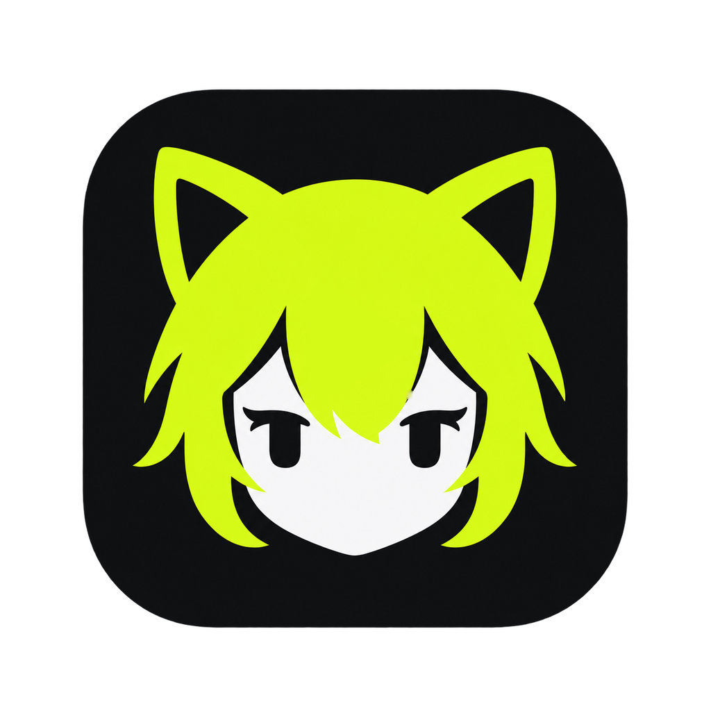
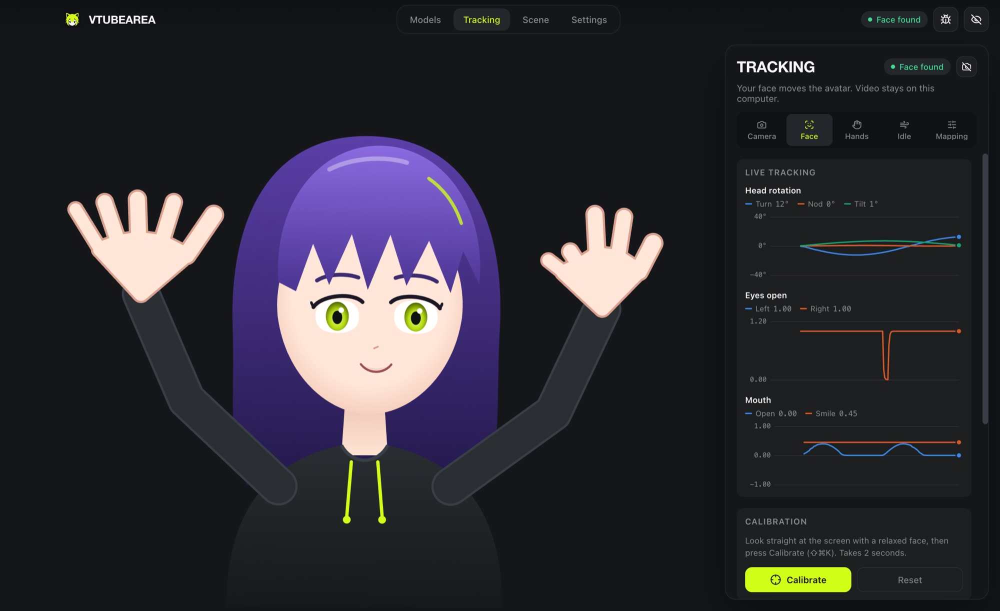
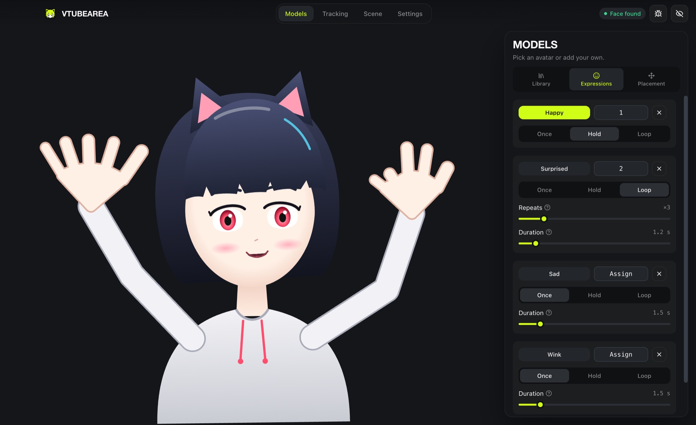
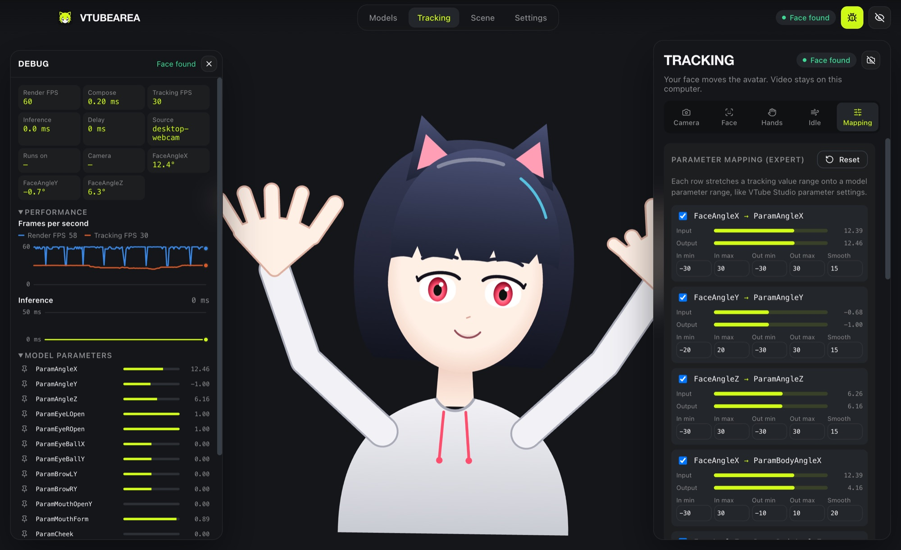

<div align="center">



# vTubeArea

**Your face, your hands, your avatar. Live, offline, free.**

A desktop VTuber studio: a 2D avatar follows your face and every finger from a webcam,<br />
with expressions on hotkeys, a stage for props and backgrounds, and nothing ever leaving your computer.

<br />


**English** · [Русский](README.ru.md)

<br />



</div>

<br />

## ✦ What it does

<table>
<tr>
<td width="50%" valign="top">

**Face tracking from any webcam**<br />
<sub>Head turn, nod and tilt, blinks, gaze, brows, mouth and smile. Calibrate in two seconds, tune one slider from responsive to smooth. Blinks adapt to your eyes, so the avatar really closes them.</sub>

</td>
<td width="50%" valign="top">

**Hands with every finger**<br />
<sub>All 21 points per hand, drawn as cartoon hands with full arms. Elbows are solved with inverse kinematics, hands touch each other and your face, and slip behind your head when you reach back.</sub>

</td>
</tr>
<tr>
<td valign="top">

**Expressions on hotkeys**<br />
<sub>Play once, hold, or loop N times. Bind <code>1</code>, <code>2</code>, <code>3</code> or any combo, and make it global so it works while you are in a game.</sub>

</td>
<td valign="top">

**A stage, not just a window**<br />
<sub>Transparent, color, chroma key, image or video backgrounds. Drop in props and stickers in front of or behind the avatar, drag, scale and rotate them.</sub>

</td>
</tr>
<tr>
<td valign="top">

**See what tracking sees**<br />
<sub>Live charts for head, eyes, mouth and hands, input → output meters for every parameter, a debug overlay with FPS, delay and all 52 face blendshapes.</sub>

</td>
<td valign="top">

**Private by design**<br />
<sub>No accounts, no telemetry, no cloud. Tracking runs on your machine with MediaPipe; the preview can even show tracking only, without your image.</sub>

</td>
</tr>
</table>

<br />

<div align="center">


</div>

<br />

## ✦ Quick start

```bash
pnpm install
pnpm setup:assets      # MediaPipe runtime + face and hand models, once
pnpm dev               # the desktop app
```

> **Needs** Node 22+, pnpm 10, Rust 1.90+. macOS needs the Xcode command line tools, Windows needs WebView2 (built into Windows 11).

The first launch installs two sample avatars, **Lumi** and **Kuro**. Then:

1. **Tracking → Start**, look straight at the screen, press **Calibrate**.
2. **Tracking → Hands** to switch on hand tracking.
3. **Scene** for the background and props.
4. Hide the interface and capture the window in OBS.

<details>
<summary><b>Streaming with OBS</b></summary>
<br />

- **macOS**: *Window Capture* of “vTubeArea”. For a see-through avatar pick **Scene → Background → None**; OBS keeps the alpha channel.
- **Windows**: transparency capture is unreliable; use **Scene → Background → Chroma key** and add OBS's *Chroma Key* filter with the same color.

</details>

<details>
<summary><b>Hotkeys</b></summary>
<br />

| Action | macOS | Windows / Linux |
| --- | --- | --- |
| Hide / show interface | <kbd>⇧</kbd><kbd>⌘</kbd><kbd>H</kbd> | <kbd>Ctrl</kbd><kbd>Shift</kbd><kbd>H</kbd> |
| Debug overlay | <kbd>⇧</kbd><kbd>⌘</kbd><kbd>D</kbd> | <kbd>Ctrl</kbd><kbd>Shift</kbd><kbd>D</kbd> |
| Calibrate | <kbd>⇧</kbd><kbd>⌘</kbd><kbd>K</kbd> | <kbd>Ctrl</kbd><kbd>Shift</kbd><kbd>K</kbd> |

Rebind them in **Settings → Hotkeys**; expressions get their own keys in **Models → Expressions**.
The 🌐 button makes a hotkey global, so it works while the app is minimized.

</details>

<details>
<summary><b>Camera tips</b></summary>
<br />

The camera sets the ceiling: a MacBook's FaceTime HD camera gives 1280×720 at 30 FPS, an iPhone used as a
Continuity Camera gives 1080p at 60 FPS. **Tracking → Camera** lists only modes your camera supports.
Above 720p tracking barely improves; it helps mostly when you sit far from the camera.

</details>

<br />

## ✦ Bring your own avatar

Models use an open, readable format: a folder with `model.json` and PNG, WebP or SVG images.
Layers, groups, parameter bindings, masks, spring physics, expressions and tracked hands with arms
are all described in [`packages/model-format/SPEC.md`](packages/model-format/SPEC.md).
Add a model with **Models → Add model**, or drop its folder onto the window.

> Live2D `.moc3` models are not supported: the format is closed and needs Live2D's proprietary SDK.

<br />

## ✦ Under the hood

```
apps/desktop          Tauri 2 · React · PixiJS        the app (UI + Rust core)
packages/protocol     FaceFrame                        one tracking format for every source
packages/model-format schema · validator · SPEC        the avatar format
packages/engine-2d    PixiJS renderer                  parameters in, pixels out
packages/ui           design system · RU/EN            shared components
assets/sample-models  Lumi, Kuro                       generated from code
```

Tracking runs MediaPipe Face and Hand Landmarker locally; every source feeds one tracking hub, so a
phone tracker can plug in later without touching the avatar side. Outside control (an AI agent, MCP or
plugins) goes through a single `AvatarControlPort`. Details in [`docs/architecture`](docs/architecture).

```bash
pnpm check             # lint + types + tests (TypeScript and Rust)
```

<br />

## ✦ Roadmap

- [x] Desktop app, own 2D model format, webcam face and hand tracking
- [x] Expressions with hotkeys, stage props, live charts, debug tools
- [ ] iPhone / Android tracker app (ARKit gives tongue and finer eyes)
- [ ] MCP / WebSocket API so an AI agent can drive the avatar
- [ ] Animations, PSD import, VRM (3D) avatars

<br />

## ✦ License

**Free for everything that is not commercial.** Use it, stream with it, study it, change it and share it:
personal use, hobby streaming, research, education and charities are all welcome.
**Building a commercial product or service on vTubeArea is not allowed.**

Licensed under [PolyForm Noncommercial 1.0.0](LICENSE). Third-party components keep their own licenses,
listed in [`THIRD_PARTY.md`](THIRD_PARTY.md). For commercial licensing, contact [@bladysh](https://github.com/bladysh).

<br />

<div align="center">
<sub>Created by <a href="https://github.com/bladysh">bladysh</a> & Claude · 2026</sub>
</div>
